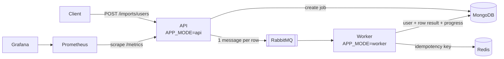

# Users Import API

NestJS API for user management with **asynchronous bulk import**: each row is published to RabbitMQ and processed by a separate worker, with per-row idempotency in Redis, error tracking and job progress. Runs locally with Docker Compose or on Kubernetes (Minikube), with Prometheus/Grafana observability and k6 stress tests.

## Highlights

- **Async processing** – `POST /imports/users` creates an import job and publishes one message per row to RabbitMQ. A worker consumes the queue with manual ack and a configurable prefetch.
- **Idempotency** – Each row gets a Redis key (`job + row number`, 24h TTL), so duplicated messages are skipped.
- **Error tracking** – Every row is stored as `success` or `error` with an error code (`INVALID_EMAIL`, `EMAIL_ALREADY_EXISTS`, `DOCUMENT_ALREADY_EXISTS`…). The job ends as `completed` or `completed_with_errors`.
- **Clean Architecture** – `domain`, `application` (use cases + ports), `infrastructure` (Mongo, Redis, RabbitMQ adapters) and `presentation` (HTTP + RabbitMQ consumer).
- **One image, two roles** – The same build runs as the HTTP API or the queue worker, selected by `APP_MODE`.
- **Observability** – `/metrics` with Prometheus (request counter + latency histogram), Grafana dashboard (RPS, p95 latency, CPU, memory) and `/health/live` / `/health/ready` probes.
- **Kubernetes** – Manifests for API (4 replicas), worker, MongoDB, Redis, RabbitMQ, Prometheus and Grafana.
- **CI/CD** – GitHub Actions builds the app and publishes the Docker image to Docker Hub.

## Architecture



## Stack

NestJS · TypeScript · MongoDB · RabbitMQ · Redis · Docker · Kubernetes (Minikube) · Prometheus · Grafana · k6 · GitHub Actions · Swagger

## Endpoints

| Method | Route | Description |
| --- | --- | --- |
| `POST` | `/users` | Create user |
| `GET` | `/users` | List users (paginated) |
| `GET` / `PATCH` / `DELETE` | `/users/:id` | Get, update or delete a user |
| `POST` | `/imports/users` | Create an import job |
| `GET` | `/imports` | List import jobs |
| `GET` | `/imports/:id` | Job status and progress |
| `GET` | `/imports/:id/errors` | Rows that failed, with error codes |
| `GET` | `/health/live`, `/health/ready` | Health checks |
| `GET` | `/metrics` | Prometheus metrics |

Swagger UI: `http://localhost:3000/docs`

## Running locally (Docker Compose)

```bash
docker compose up -d --build
```

Starts the API, the worker, MongoDB, Redis, RabbitMQ (management UI on `:15672`) and Mongo Express (`:8081`).

## Running on Kubernetes (Minikube)

```bash
minikube start --driver=docker --cpus=4 --memory=6144
minikube kubectl -- apply -f k8s/
minikube kubectl -- get deploy,pods,svc,pvc -n users-import
```

## Stress tests (k6)

```bash
docker run --rm -i -v "${PWD}:/work" -w /work/stress grafana/k6 run k6-import-users.js \
  -e BASE_URL=http://host.docker.internal:30080 -e DURATION=120s -e JOBS_PER_SECOND=3 -e ROWS_PER_JOB=10
```

## Further docs (Portuguese)

- [Project overview](explain/project-overview.md)
- [Kubernetes with Minikube](explain/k8s-minikube.md)
- [Stress tests](explain/stress-tests.md)
- [Commands cheatsheet](explain/commands-cheatsheet.md)
- [Glossary](explain/glossary.md)

---

Built by [Silas Santos](https://github.com/silasoli) · [LinkedIn](https://www.linkedin.com/in/silasoli/)
